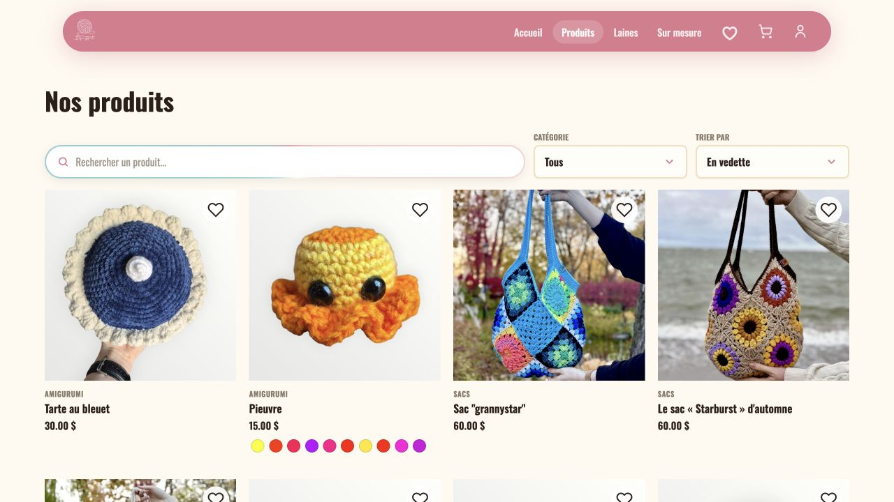
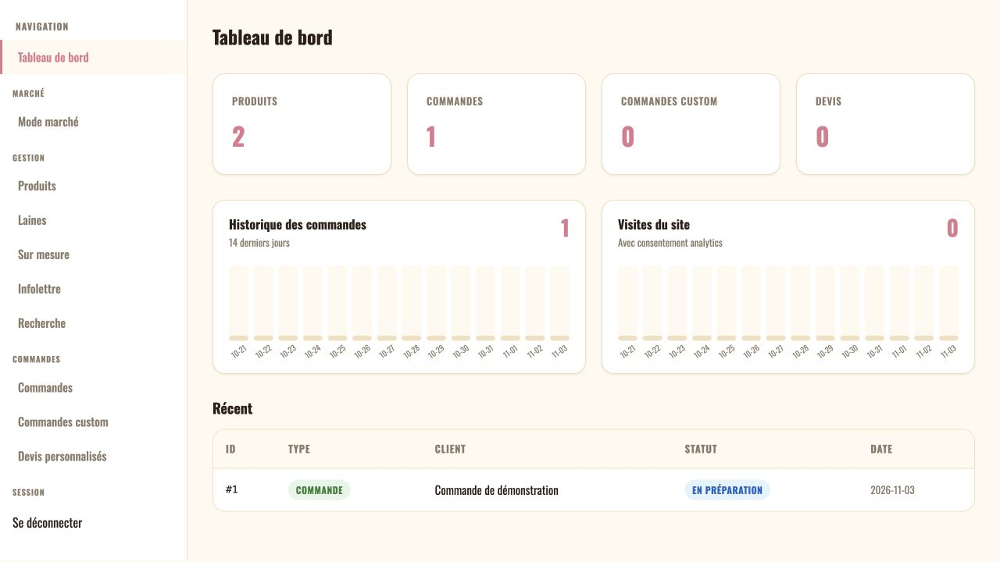
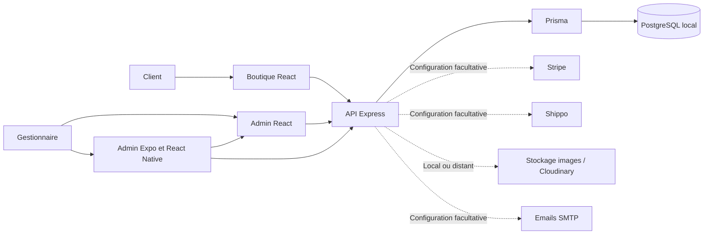

# Itsgenygarts Portfolio

**Une plateforme e-commerce pour créations au crochet, avec boutique bilingue, commandes sur mesure, administration web et outils de vente en personne.**

Ce dépôt présente une application qui couvre le parcours complet d'une boutique artisanale : mettre des produits en ligne, suivre les variantes et le stock, recevoir des demandes personnalisées, préparer des devis, encaisser des commandes et organiser leur expédition.

La copie portfolio se lance avec une base PostgreSQL locale et des données fictives. Les intégrations de paiement, d'expédition, d'email et de notifications sont configurables séparément. Aucun accès au serveur de production, ancien historique Git, compte Firebase réel ou export de clients n'est fourni.

[](https://github.com/philhurtu99/Itsgenygarts-portfolio/actions/workflows/ci.yml)

**Stack :** React 18 · Vite · Node.js · Express · Prisma · PostgreSQL · Jest · Expo / React Native.

## Sommaire

- [Aperçu en images](#aperçu-en-images)
- [Boutique et espace client](#boutique-et-espace-client)
- [Administration web](#administration-web)
- [Administration mobile et vente en personne](#administration-mobile-et-vente-en-personne)
- [Architecture](#architecture)
- [Parcours métier](#parcours-métier)
- [Lancer la démonstration locale](#lancer-la-démonstration-locale)
- [Intégrations et configuration](#intégrations-et-configuration)
- [Tests et vérifications](#tests-et-vérifications)
- [Organisation du dépôt](#organisation-du-dépôt)

## Aperçu en images

Les captures de la boutique proviennent du [site public Itsgenygarts](https://itsgenygarts.com/). Le catalogue réel et ses photographies illustrent le site en activité; la démonstration locale de ce dépôt utilise plutôt les produits fictifs fournis par le script de données de démonstration.

### Accueil de la boutique


### Catalogue et filtres



### Tableau de bord administrateur

Cette capture provient de l'instance locale avec des données entièrement fictives. Elle montre les indicateurs, l'historique d'activité et le suivi des commandes, sans renseignements de clients réels.



## Boutique et espace client

### Catalogue et fiches produit

- Navigation par catégories, produits mis en vedette et catalogue de laines.
- Fiches avec galerie d'images, prix, description et informations détaillées sur le produit.
- Variantes de couleur, images associées, état disponible/vendu et gestion de l'affichage des variantes vendues.
- Contenus français et anglais pour les produits et catégories, avec langue de navigation conservée côté client.
- Informations complémentaires : taille et coupe, matières, entretien et guide des tailles lorsqu'ils sont renseignés.
- Favoris et panier accessibles avant la connexion; synchronisation avec le compte client après authentification.

### Comptes et suivi des achats

- Inscription, confirmation d'email et renvoi du lien de vérification.
- Connexion, déconnexion et récupération de mot de passe.
- Espace personnel avec historique des commandes et téléchargement des factures PDF autorisées.
- Demande de suppression du compte avec confirmation.
- Préremplissage des coordonnées pour simplifier les demandes et le passage de commande.

### Panier, paiement et livraison

- Panier avec quantités, variantes, calcul des montants et choix de devise parmi celles activées.
- Calcul de livraison selon la destination, le contenu du panier et les règles disponibles.
- Stripe Checkout, page de confirmation et traitement des événements de paiement par webhook.
- Réservation temporaire des articles pendant le paiement; libération du stock lors d'une annulation ou de l'expiration d'une commande en attente.
- Informations d'expédition, suivi et factures rattachés aux commandes.
- Collecte des informations douanières et acceptation des conditions liées aux frais d'importation lorsque le parcours le demande. Les destinations restent soumises aux contrôles prévus dans le code; il ne faut pas considérer une destination comme ouverte sans configuration validée.

### Commandes sur mesure et demandes de devis

- Formulaire de commande personnalisée : catégorie, modèle de référence, choix de couleurs et options dépendant de la catégorie.
- Description libre et images de référence pour expliquer la création souhaitée.
- Demandes de devis personnalisés et demandes issues d'un panier de produits.
- Coordonnées et langue du client conservées pour le suivi de la demande.
- Affichage configurable du parcours sur mesure, y compris une page d'attente lorsqu'il n'est pas activé.

### Contenu et expérience de navigation

- Interface adaptée aux écrans mobiles, navigation bilingue, FAQ et pages d'information.
- Pages de confidentialité, conditions, retours et informations de contact configurables.
- Gestion du consentement aux cookies et suivi des pages pour les statistiques de la boutique.
- Métadonnées de partage et génération de `robots.txt` et `sitemap.xml` à partir de l'adresse configurée pour cette copie.

## Administration web

L'application `admin/` possède sa propre interface React et ses routes protégées. L'API contrôle le rôle administrateur et l'état du compte pour les opérations de gestion.

| Espace | Fonctionnalités |
| --- | --- |
| **Tableau de bord** | Vue d'ensemble de l'activité, éléments récents, alertes sur les commandes et demandes à traiter, liens vers les tâches correspondantes. |
| **Produits et variantes** | Création et modification des fiches, prix, descriptions FR/EN, brouillons, mise en vedette, stock et variantes; recherche, filtres de statut/catégorie et tri par prix. |
| **Médias des produits** | Ajout et suppression d'images, ordre des galeries, association de photos à des variantes et photos de présentation. |
| **Catégories** | Gestion depuis l'espace Produits : libellés et descriptions FR/EN, ordre d'affichage et activation. |
| **Laines** | Catalogue séparé, catégories, images, prix, quantité disponible et actions de gestion. |
| **Commandes classiques** | Consultation des articles et coordonnées, suivi des états, envoi de messages, informations de paiement, préparation et expédition. |
| **Étiquettes d'expédition** | Parcours Shippo pour créer ou rapprocher une étiquette, récupérer le PDF et les documents douaniers disponibles, et conserver les informations de suivi. Cette fonction demande une configuration externe. |
| **Commandes personnalisées** | Consultation des options et images de référence, suivi du statut, définition du prix, messages au client, lien de paiement et photo du produit terminé. |
| **Devis personnalisés** | Consultation de la demande, tarification, changement d'état, échanges par email et lien de paiement. |
| **Demandes de devis panier** | Lecture des produits demandés, montants et coordonnées; suivi jusqu'à la finalisation. |
| **Catégories du sur mesure** | Configuration des catégories, options et modèles/références proposés dans les formulaires clients. |
| **Mode marché** | Interface de caisse pour les produits, les laines et les commandes personnalisées; panier de vente, enregistrement du moyen de paiement, lien ou QR de paiement et prise en charge de Stripe Terminal selon la configuration. |
| **Newsletter** | Consultation des abonnés et envoi de messages aux destinataires concernés, avec gestion du désabonnement. |
| **Recherche globale** | Recherche administrative transversale pour retrouver les éléments de la boutique. |
| **Notes et suivi opérationnel** | Notes internes liées aux entités et chronologie des événements disponibles dans l'API de gestion. |

Le backend expose aussi des ressources d'administration pour les zones de livraison, tarifs par produit, devises et profils douaniers. Un composant `ShippingAndCurrencies.jsx` est présent dans les sources; il n'est pas raccordé comme page autonome dans le routeur admin actuel. Cette distinction permet de voir ce qui est accessible dans la navigation et ce qui reste disponible au niveau des modules et de l'API.

Les paramètres de connexion aux fournisseurs sont fournis par l'environnement. L'admin web n'est pas un coffre de clés API et ne contient pas les credentials des services réels.

## Administration mobile et vente en personne

L'application `mobile-admin/` est construite avec Expo et React Native. Elle combine :

- Une WebView limitée à l'origine de l'administration configurée.
- Une session administrative et un stockage sécurisé des informations locales nécessaires.
- Des notifications push Expo, après configuration d'un projet personnel et autorisation sur un appareil réel.
- Des écrans/actions natifs Stripe Terminal et Tap to Pay, avec gestion de la connexion, des permissions et des erreurs de l'appareil.
- La consultation des produits, commandes et demandes, ainsi que les opérations de stock et de vente exposées par l'API.

La présence de ces fonctions dans le code ne signifie pas qu'Expo Go suffit pour les tester : Stripe Terminal exige une build native et un environnement compatible. Les comptes Expo/EAS, Firebase/APNs, identifiants d'application et paramètres de paiement de la production ne sont pas inclus.

## Architecture



| Couche | Responsabilité |
| --- | --- |
| `frontend/` | Catalogue, panier, compte client, formulaires et navigation publique. |
| `admin/` | Outils quotidiens de gestion, commandes, caisse et suivi. |
| `backend/src/routes/` | Points d'entrée HTTP, validation et droits d'accès. |
| `backend/src/services/` | Paiements, expédition, emails, factures, médias et traitements métier. |
| `backend/src/utils/` | Fonctions partagées pour langues, cookies, tokens, montants et données d'expédition. |
| `backend/prisma/` | Modèle relationnel, migrations et initialisation locale. |
| `mobile-admin/` | Accès mobile à l'admin et intégrations natives. |

Le modèle de données relie notamment produits, variantes, médias, réservations de stock, articles de commande, demandes sur mesure, clients, comptes administrateurs et notes internes. Les données de paiement restent représentées par les identifiants et états nécessaires au suivi; les opérations externes passent par les services dédiés.

## Parcours métier

**Commande classique.** Le client choisit un produit et sa variante, remplit son panier, renseigne la destination puis passe au paiement. Le backend réserve le stock et crée la session Stripe. Le webhook met à jour la commande après réception de l'événement correspondant. L'administration prend ensuite en charge la préparation et l'expédition.

**Création sur mesure.** Le client décrit sa demande et joint des références. L'administrateur consulte la demande, précise le prix et peut envoyer un lien de paiement. Les états, messages, paiements et images finales permettent de suivre le travail.

**Vente en marché.** L'administrateur constitue une vente à partir des articles disponibles ou d'une demande personnalisée, choisit le moyen de paiement et enregistre l'opération. Les intégrations Stripe permettent aussi des parcours de paiement en personne lorsqu'elles sont configurées.

## Lancer la démonstration locale

### Prérequis

- Node.js 22 et npm.
- PostgreSQL local, ou Docker Compose pour la base de démonstration fournie.
- Aucun compte de production requis pour explorer le catalogue, la base locale, les comptes fictifs et l'administration.

### 1. Installer et créer la configuration locale

```bash
git clone https://github.com/philhurtu99/Itsgenygarts-portfolio.git
cd Itsgenygarts-portfolio
npm run install:all
npm run setup:local
```

Le setup crée les `.env` manquants et génère un secret JWT et un mot de passe aléatoires. Il conserve les fichiers déjà présents. Les credentials générés restent dans `backend/.env`, ignoré par Git.

### 2. Démarrer une base dédiée et initialiser les données fictives

```bash
docker compose up -d db
npm --prefix backend run db:generate
npm --prefix backend run db:deploy
npm --prefix backend run db:seed
npm --prefix backend run db:seed:demo
```

Le Compose de cette copie fournit uniquement PostgreSQL, lié à `127.0.0.1:55432`. Les identifiants locaux d'exemple correspondent à `backend/.env.example`; ils ne donnent accès à aucun service réel. Avec une autre installation PostgreSQL, créer une base contenant `portfolio` dans son nom et adapter `DATABASE_URL`.

Le seed de démonstration ajoute un petit catalogue bilingue, des variantes, une laine, une devise, une zone de livraison, un compte client et une commande fictive. Il refuse une base distante ou un environnement de production. Il ne lance aucun paiement, email ou achat d'étiquette.

### 3. Démarrer les trois applications

Dans trois terminaux séparés :

```bash
npm --prefix backend run dev
```

```bash
npm --prefix frontend run dev
```

```bash
npm --prefix admin run dev
```

| Accès | Adresse | Compte local |
| --- | --- | --- |
| Boutique | `http://localhost:3000` | Consultation libre; `client@example.test` pour le compte fictif. |
| Administration | `http://localhost:3002` | `admin@example.test`. |
| API | `http://localhost:3001/api` | Selon le droit requis par la route. |
| Santé API | `http://localhost:3001/api/health` | Vérification du service. |

Les deux comptes de démonstration utilisent le mot de passe généré dans `ADMIN_SEED_PASSWORD` de `backend/.env`. Pour explorer la base :

```bash
npm --prefix backend run db:studio
```

### Mobile facultatif

```bash
npm run install:mobile
npm run mobile:dev
```

Pour un téléphone physique, renseigner l'adresse LAN de l'ordinateur et ouvrir l'API sur ce réseau pour ce test. Les détails et les intégrations natives sont décrits dans [la configuration de la démonstration](docs/CONFIGURATION.md).

## Intégrations et configuration

| Fonction | Exploration locale | Configuration externe nécessaire |
| --- | --- | --- |
| Catalogue, favoris, panier, comptes seedés | Base locale et données fictives. | Aucune clé fournisseur. |
| Gestion des produits et médias | Stockage d'images local en développement. | Cloudinary facultatif. |
| Commandes, demandes et statuts | Consultation et opérations métier locales. | Les paiements et emails associés demandent leurs services. |
| Paiement en ligne | Code, tests et contrats d'API inclus. | Clés Stripe de test et webhook local. |
| Livraison et étiquettes | Modèles, validations et tests inclus. | Shippo, origine d'expédition et configuration transporteur. |
| Emails et vérification de nouveaux comptes | Comptes fictifs déjà vérifiés pour commencer. | Serveur SMTP de test pour les nouveaux parcours email. |
| Notifications mobiles et Tap to Pay | Code et gestion des états inclus. | Projet Expo/EAS personnel, Firebase/APNs, build native et configuration Stripe selon la fonction. |

Les fichiers `.env.example` constituent la référence de configuration. Les services externes ne sont pas présentés comme opérationnels sans clés : leur absence ne transforme pas la démonstration en boutique de paiement active. Ne pas utiliser les données fictives pour une expédition réelle.

## Tests et vérifications

```bash
# Toutes les suites web/API
npm test

# Une application
npm --prefix backend test -- --runInBand
npm --prefix frontend test -- --runInBand
npm --prefix admin test -- --runInBand

# Couverture
npm run coverage

# Suites, génération Prisma et compilations web
npm run check
```

Les suites couvrent notamment l'authentification, les droits d'administration, les produits et variantes, les paniers et favoris, les commandes, les paiements, les emails, l'expédition, les images et les composants d'interface. Les intégrations sont testées avec des doubles de test : une suite verte ne remplace pas une validation réelle de Stripe Terminal, des fournisseurs ou des profils douaniers.

Validation locale de cette copie : **939 tests automatisés réussis** (API, boutique et admin), compilations des deux applications web réussies, migrations et seeds validés sur une base PostgreSQL isolée. La connexion admin et la protection des routes ont aussi été vérifiées sur l’API locale.

Le workflow CI de cette copie utilise uniquement une machine GitHub hébergée pour les tests et les compilations. Il ne contient aucune étape de déploiement, aucun secret configuré et aucun runner lié à un serveur de boutique.

## Organisation du dépôt

```text
Itsgenygarts-portfolio/
├── frontend/       Boutique React, contenus FR/EN et tests
├── admin/          Administration web et tests
├── backend/        API, services métier, Prisma, migrations et tests
├── mobile-admin/   Application Expo / React Native
├── docs/           Configuration et notes techniques
├── scripts/        Initialisation et outils locaux
├── .github/        CI de validation sur GitHub hébergé
└── compose.yaml    Base PostgreSQL de démonstration
```

Cette version permet d'examiner le code et d'explorer le produit dans un environnement indépendant. Elle ne distribue ni l'ancien historique de production ni ses automatisations de déploiement. Les illustrations du petit catalogue local sont des exemples; les images, comptes et commandes de vrais clients ne sont pas importés.
